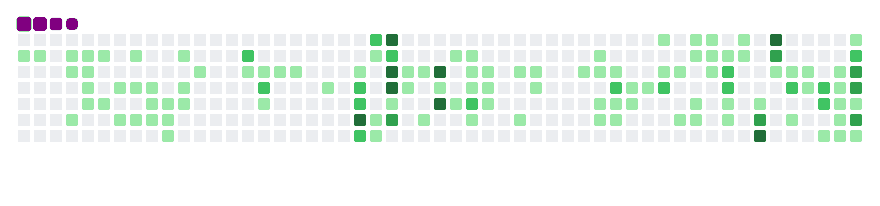

<link rel="stylesheet" href="https://use.fontawesome.com/releases/v5.14.0/css/all.css" integrity="sha384-HzLeBuhoNPvSl5KYnjx0BT+WB0QEEqLprO+NBkkk5gbc67FTaL7XIGa2w1L0Xbgc" crossorigin="anonymous">

<h1 align="center">
    
</h1>

### :rocket: About me

:mortar_board: _I studied at the University of Science, VNU-HCM, and work as a full-stack developer._

:computer: _I focus on backend development for web applications, Python,Golang and their framework. I also work with HTML, CSS, and JavaScript._

:information_desk_person: _I'm interested in the technologies around web development, especially cloud computing, DevOps, and AI._

  
  <a href="https://mail.google.com/mail/?view=cm&amp;fs=1&amp;to=sungphan27082002%40gmail.com&amp;su=Collaboration%20inquiry" target="_blank">
      <!-- sqlite, safari, google-chrome are other good icon options -->
  </a>

  

### :hammer: Languages-Frameworks-Tools

     
     
     
     

### :pencil: My Contributions

### :fire: GitHub Stats

<!-- Updated daily by .github/workflows/update-readme-stats.yml -->
 

  
  

<h3 align="center">
    
</h3>
